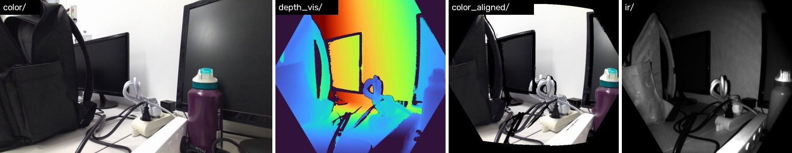
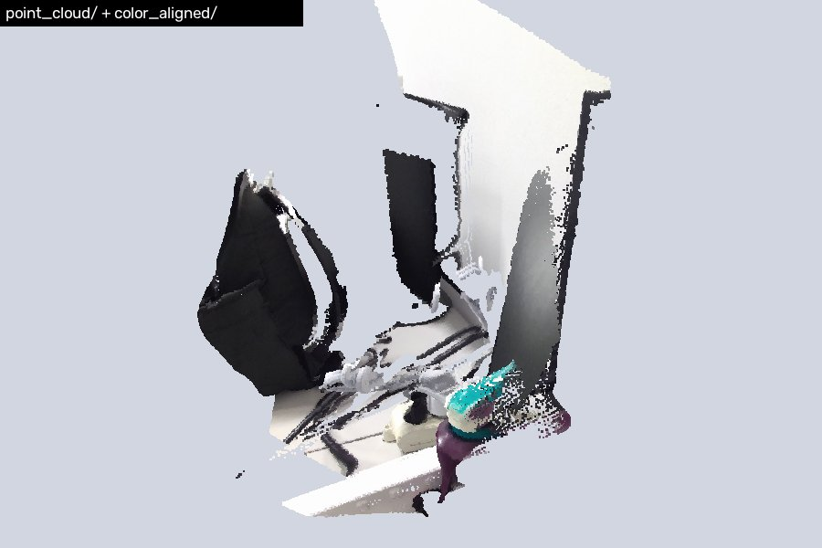
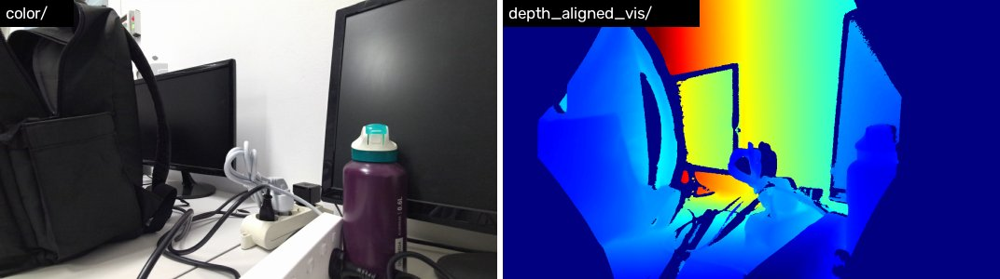

# Azure Kinect DK Ubuntu Tools

[中文版](README_cn.md)

This repository contains Ubuntu-based tools for Azure Kinect DK, including device setup, video recording, MKV export, camera intrinsic export, IMU export, and lightweight post-processing utilities for depth and IMU data.

## 1. What This Repository Provides

The repository is organized around two workflows. MKV files recorded by either one (MJPG color) can be exported by both.

- A pyk4a-based recording and export pipeline for direct Python access to color, depth, IR, point-cloud, and IMU data.
- An Open3D-based recording and export pipeline using Open3D's Azure Kinect MKV interfaces.
- Several helper scripts for camera parameter export, depth-value inspection, and simple IMU trajectory estimation.

## 2. Environment Setup

Verified on Ubuntu 24.04 and 26.04. Microsoft only ships Ubuntu 18.04 deb packages, but they install and work on newer releases.

### 2.1 Install the K4A SDK

```bash
mkdir -p ~/azure_kinect && cd ~/azure_kinect

wget https://packages.microsoft.com/ubuntu/18.04/prod/pool/main/libk/libk4a1.4/libk4a1.4_1.4.1_amd64.deb
wget https://packages.microsoft.com/ubuntu/18.04/prod/pool/main/libk/libk4a1.4-dev/libk4a1.4-dev_1.4.1_amd64.deb
wget https://packages.microsoft.com/ubuntu/18.04/prod/pool/main/k/k4a-tools/k4a-tools_1.4.1_amd64.deb
wget http://ftp.de.debian.org/debian/pool/main/libs/libsoundio/libsoundio1_1.1.0-1_amd64.deb
wget https://raw.githubusercontent.com/microsoft/Azure-Kinect-Sensor-SDK/develop/scripts/99-k4a.rules

# Installing with apt pulls in missing dependencies (e.g. libjack-jackd2-0)
sudo apt install ./libsoundio1_1.1.0-1_amd64.deb
sudo apt install ./libk4a1.4_1.4.1_amd64.deb ./libk4a1.4-dev_1.4.1_amd64.deb ./k4a-tools_1.4.1_amd64.deb

# udev rules: access the camera without sudo
sudo cp 99-k4a.rules /etc/udev/rules.d/
sudo udevadm control --reload-rules
sudo udevadm trigger
```

- Installing libk4a1.4 opens a Microsoft EULA dialog that defaults to No. Select Yes with the arrow or Tab keys and press Enter, or the install fails. Keep that terminal open until it finishes.
- Unplug and replug the camera afterwards so the udev rules apply.
- The camera must be on a USB 3 port. `lsusb | grep 045e` should list both the Depth Camera and the 4K Camera.
- If package versions change, prefer the Microsoft official documentation over this pinned example.

### 2.2 Raise the USB Buffer Limit

Linux defaults to a 16 MB usbfs buffer, which triggers `libusb ... errno=12` and can drop frames. Raise it to 1000 MB:

```bash
# take effect now
echo 1000 | sudo tee /sys/module/usbcore/parameters/usbfs_memory_mb

# persist across reboots
echo 'GRUB_CMDLINE_LINUX_DEFAULT="$GRUB_CMDLINE_LINUX_DEFAULT usbcore.usbfs_memory_mb=1000"' \
  | sudo tee /etc/default/grub.d/99-k4a-usbfs.cfg
sudo update-grub
```

### 2.3 Verify the Device

```bash
k4arecorder --list   # should print the serial number and firmware versions
k4aviewer            # Open Device → Start
```

### 2.4 Python Environment

pyk4a builds against the K4A SDK, so finish 2.1 first. Python ≥ 3.10 is required. Use either conda or pip:

```bash
# conda (recommended)
conda env create -f environment.yml
conda activate k4a

# or pip
pip install -r requirements.txt
```

requirements.txt lists the tested versions (Python 3.10, numpy 2.2, pyk4a 1.5, open3d 0.20, etc.).

## 3. Repository Layout

```text
config/                  Azure Kinect recording configs
Configuration details/   reference notes
docs/images/             README sample screenshots
video/                   recorded MKV files and IMU CSVs
output/                  exported outputs (layout: see 5.6)

recorder_pyk4a.py        record MKV + IMU via pyk4a
export_pyk4a.py          export depth, RGB, IR, point cloud, intrinsics
recorder_open3d.py       record MKV via Open3D
export_open3d.py         export color and color-aligned depth via Open3D
imu_trajectory.py        estimate trajectory from IMU CSV
read depth.py            inspect depth .npy statistics
test.py                  minimal intrinsic export example
requirements.txt         pip dependencies
environment.yml          conda environment
```

## 4. Configuration Files

The repository includes three camera presets, all with MJPG color:

- config/720p_NFOV_UNBINNED.json: 720P color, NFOV_UNBINNED depth, 30 FPS.
- config/720p_WFOV_UNBINNED.json: 720P color, WFOV_UNBINNED depth, 15 FPS.
- config/1080p_WFOV_UNBINNED.json: 1080P color, WFOV_UNBINNED depth, 15 FPS.

Notes:

- The recorders' `-c` option accepts a preset name (e.g. `720p_WFOV_UNBINNED`) or a path to any JSON file.
- WFOV_UNBINNED does not support frame rates above 15 FPS, and both recorders check for that combination.
- Both recorders honor `color_format`. Keep MJPG: the camera outputs MJPG natively and BGRA32 is just the SDK decoding it on the host, so image quality is identical, while BGRA32 files are about 3x larger, recording uses more CPU, and Open3D cannot read them.

## 5. Quick Start

All scripts use relative paths, so run them from the repository root inside the `k4a` environment. Every script supports `-h` for its full option list and falls back to built-in defaults when run without arguments. Only one process can open the camera at a time; close k4aviewer before recording.

A complete example run (scene name `demo`):

```bash
python recorder_pyk4a.py -n demo --duration 10     # → video/demo.mkv, video/demo_imu.csv
python export_pyk4a.py -n demo                     # → output/demo/pyk4a/
python export_open3d.py -n demo --vis-max 1500     # → output/demo/open3d/
python imu_trajectory.py -n demo                   # → output/demo/imu/
python "read depth.py" demo                        # depth statistics
```

### 5.1 Record with pyk4a

```bash
python recorder_pyk4a.py -n demo -c 720p_NFOV_UNBINNED --duration 10
python recorder_pyk4a.py -n demo --exposure 2500    # manual 2.5 ms exposure, stop with Ctrl+C
```

| Option | Default | Description |
|---|---|---|
| `-n, --name` | `wet_pyk4a` | scene name |
| `-c, --config` | `720p_NFOV_UNBINNED` | preset name or JSON path |
| `--exposure US` | auto | manual exposure in µs (500–133330) |
| `--duration SEC` | until Ctrl+C | recording length |

Writes video/<name>.mkv and video/<name>_imu.csv (IMU at about 1.6 kHz). 720P + NFOV_UNBINNED 30 FPS is about 50 MB/s, mostly uncompressed depth and IR. Sample output:

```text
================================================================================
FPS=30  Resolution=720P  DepthMode=NFOV_UNBINNED  ColorFormat=MJPG
================================================================================
✓ Auto exposure enabled
================================================================================
Recording → video/demo.mkv
IMU CSV   → video/demo_imu.csv
Recording for 4.0s (Ctrl+C to stop early)
================================================================================
IMU saved: 6608 samples → video/demo_imu.csv
MKV saved: 117 frames → video/demo.mkv
```

### 5.2 Export with pyk4a

```bash
python export_pyk4a.py -n demo
python export_pyk4a.py -i /path/to/clip.mkv -o /path/to/out
```

| Option | Default | Description |
|---|---|---|
| `-n, --name` | `wet_pyk4a` | reads video/<name>.mkv |
| `-i, --input` | — | MKV path, overrides `--name` |
| `-o, --output` | `output/<name>/pyk4a` | output directory |

Both MJPG and BGRA32 recordings are supported; captures missing depth or color are skipped. Depth-related data is in the **depth camera frame** (576×640 for NFOV_UNBINNED); see 5.6 for the layout.

```text
Reached end of MKV file.
Processed 117 captures, saved 117, skipped 0 incomplete → output/demo/pyk4a
```

Sample output (same frame): color, depth colormap, color aligned to the depth camera, IR.



Combining point_cloud/ with color_aligned/ gives a colored point cloud:



### 5.3 Record with Open3D

```bash
python recorder_open3d.py -n demo_o3d -c 720p_NFOV_UNBINNED --duration 10
```

Same options as 5.1 (without `--exposure`); the default scene name is `wet_open3d`. Writes video/<name>.mkv only, without an IMU CSV.

### 5.4 Export with Open3D

```bash
python export_open3d.py -n demo_o3d
python export_open3d.py -n demo --vis-max 1500
```

| Option | Default | Description |
|---|---|---|
| `-n, --name` | `wet_open3d` | reads video/<name>.mkv |
| `-i, --input` | — | MKV path, overrides `--name` |
| `-o, --output` | `output/<name>/open3d` | output directory |
| `--vis-min`, `--vis-max` | `0`, `550` | fixed depth colormap range in mm |

**Open3D aligns depth to the color camera**, so it has the color resolution; pair it with intrinsic_color.txt. Only MJPG recordings can be read.

Sample output (`--vis-min 200 --vis-max 1100`):



### 5.5 Compatibility

| Recorded with | export_pyk4a.py | export_open3d.py |
|---|---|---|
| recorder_pyk4a.py (MJPG) | ✓ | ✓ |
| recorder_open3d.py (MJPG) | ✓ | ✓ |
| k4arecorder (MJPG by default) | ✓ | ✓ |
| Legacy BGRA32 recordings | ✓ | ✗ |

### 5.6 Output Layout

All results for one scene live under output/<name>/, split by method. Per-frame files are named by frame index (`000000.png` / `000000.npy`); a `_aligned` suffix means the data is reprojected into the other camera's frame.

```text
output/<name>/
├── pyk4a/                     export_pyk4a.py — depth camera frame
│   ├── color/                 raw color (.png)
│   ├── depth/                 raw depth (uint16 .npy, mm)
│   ├── depth_vis/             depth colormap, per-frame 2–98% stretch (.png)
│   ├── color_aligned/         color reprojected into the depth camera (.png)
│   ├── ir/                    IR (uint16 .npy)
│   ├── point_cloud/           point cloud (H×W×3 .npy, mm)
│   ├── intrinsic_color.txt    intrinsic_depth.txt
│   └── distortion_color.txt   distortion_depth.txt
├── open3d/                    export_open3d.py — color camera frame
│   ├── color/                 color (.png)
│   ├── depth_aligned/         depth reprojected into the color camera (uint16 .npy, mm)
│   ├── depth_aligned_vis/     depth colormap, fixed range (.png)
│   ├── intrinsic_color.txt    intrinsic_depth.txt
│   └── distortion_color.txt   distortion_depth.txt
└── imu/                       imu_trajectory.py
    ├── trajectory.csv
    └── trajectory.png
```

Mapping from the old layout (old data still works with `read depth.py`):

| Old | New |
|---|---|
| `output/<name>_export/depth_raw/`, `rgb_raw/`, `rgb_aligned/<i>_aligned.png`, `ir_raw/` | `output/<name>/pyk4a/depth/`, `color/`, `color_aligned/<i>.png`, `ir/` |
| `output/<name>/depth/` (Open3D) | `output/<name>/open3d/depth_aligned/` + `depth_aligned_vis/` |
| `output/<name>/K_rgb.txt`, `K_depth.txt` | `output/<name>/open3d/intrinsic_color.txt`, `intrinsic_depth.txt` |
| `output/imu_trajectory_est.csv` / `.png` | `output/<name>/imu/trajectory.csv` / `.png` |

## 6. Helper Scripts

### 6.1 IMU Trajectory Estimation

```bash
python imu_trajectory.py -n demo
python imu_trajectory.py -i video/other_imu.csv -o output/other/imu --static-sec 3
```

Reads video/<name>_imu.csv, performs simple gyro integration, gravity compensation, and a basic ZUPT heuristic, and writes to output/<name>/imu/. `--static-sec` is how long the camera stays still at the start (default 2 s), used for bias estimation. Pure IMU double integration drifts quickly, so treat the result as a rough estimate only.

### 6.2 Depth Data Inspection

```bash
python "read depth.py" demo                    # pyk4a/depth first
python "read depth.py" demo --method open3d    # open3d/depth_aligned
python "read depth.py" output/demo/pyk4a/depth # any directory
```

Prints per-file and global statistics, excluding invalid zero pixels and reporting the valid-pixel ratio separately. Only depth directories are read, so IR and point clouds are never mixed in. The script prints its summary in Chinese:

```text
Depth directory: output/demo/pyk4a/depth
000000.npy: min=151.0, max=971.0, median=339.0, mean=467.9, valid=43.1%
...
================================================================================
总文件数: 117
有效像素比例: 43.0%（以下统计均已排除 0 值）
全局最小值: 151.0 (文件: 000000.npy)
全局最大值: 2744.0 (文件: 000009.npy)
全局平均值(所有有效像素): 467.0951710392246
按帧平均值(每帧mean再平均): 467.0942044865749
按帧中位数(每帧median再平均): 338.22222222222223
```

### 6.3 Intrinsic Export Example

test.py shows a minimal example of reading the depth-camera intrinsic matrix directly from pyk4a and saving it to a text file.

```bash
python test.py
```

## 7. K4A Command-Line Tools

After installing the SDK, use the official tools to verify the device is working.

```bash
k4arecorder --list
k4aviewer
k4aviewer -HighDPI
k4arecorder -h
k4arecorder -d NFOV_UNBINNED -c 1080p -r 5 output.mkv
```

## 8. Troubleshooting

| Symptom | Cause and fix |
|---|---|
| `LIBUSB_ERROR_BUSY` | Another process (k4aviewer, another recorder) already has the camera open. Close it and retry. |
| `libusb ... errno=12` | The usbfs buffer is too small; see 2.2. |
| Cannot open the device without sudo | udev rules not applied: check `/etc/udev/rules.d/99-k4a.rules` exists and replug the camera. |
| apt install hangs | The EULA dialog is waiting for input; if its terminal was closed, find it with `ps aux \| grep whiptail`, kill it, and reinstall. |
| Open3D reports `Unexpected image format` and exports 0 frames | The MKV was recorded as BGRA32, which Open3D cannot read. Use export_pyk4a.py or re-record with MJPG. |
| `[Warning] Frame lag` only at the start | The first frame is slow while the camera starts; safe to ignore. |
| Firmware version warning | SDK 1.4.1 recommends RGB 1.6.110 / Depth 1.6.80; older firmware still works. |

## 9. Current Usage Pattern in This Repository

The scripts are lab utilities; keep these traits in mind:

- The two exporters use different depth frames: pyk4a keeps the depth camera, Open3D aligns to color. Pick intrinsics accordingly.
- The code is intended for local experimentation, without logging or batch orchestration.

## 10. References

- Azure Kinect Sensor SDK: https://github.com/microsoft/Azure-Kinect-Sensor-SDK
- pyk4a: https://github.com/etiennedub/pyk4a
- Open3D Azure Kinect docs: Configuration details/open3d_azure.markdown
- Depth mode note: Configuration details/depth_mode.markdown

## TODO LIST

- Support batch processing of multiple scenes.
