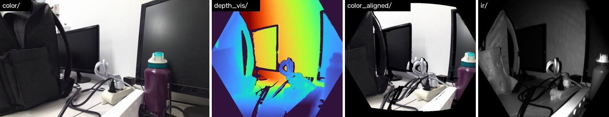
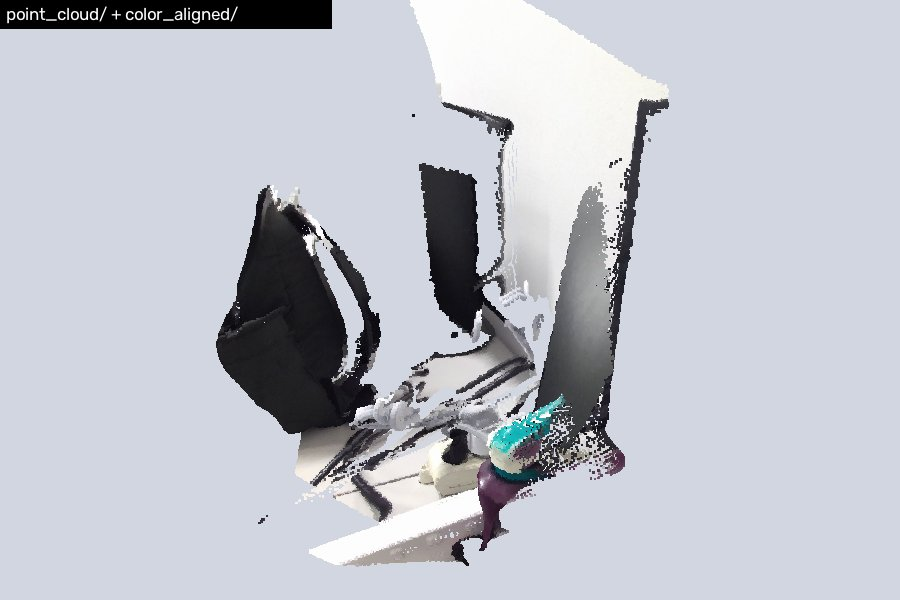
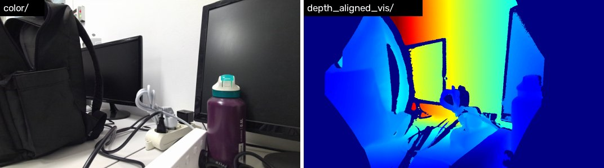

# Azure Kinect DK Ubuntu Tools

[English](README.md)

这是一个面向 Azure Kinect DK 的 Ubuntu 开发工具仓库，覆盖设备安装、视频录制、MKV 导出、相机内参保存、IMU 数据导出，以及基于深度和 IMU 的简单后处理脚本。

## 1. 项目内容

仓库主要分成两条工作流，两者录制的 MKV（MJPG 彩色）可以互相导出。

- 基于 pyk4a 的录制与导出流程，适合直接在 Python 中访问彩色、深度、IR、点云和 IMU 数据。
- 基于 Open3D 的录制与导出流程，适合使用 Open3D 自带的 Azure Kinect MKV 读写接口。
- 若干辅助脚本，用于导出相机参数、统计深度图数据、以及从 IMU CSV 估计简单轨迹。

## 2. 环境配置

已在 Ubuntu 24.04 和 26.04 上验证。官方只提供 Ubuntu 18.04 的 deb 包，但在新版 Ubuntu 上可以正常安装使用。

### 2.1 安装 K4A SDK

```bash
mkdir -p ~/azure_kinect && cd ~/azure_kinect

wget https://packages.microsoft.com/ubuntu/18.04/prod/pool/main/libk/libk4a1.4/libk4a1.4_1.4.1_amd64.deb
wget https://packages.microsoft.com/ubuntu/18.04/prod/pool/main/libk/libk4a1.4-dev/libk4a1.4-dev_1.4.1_amd64.deb
wget https://packages.microsoft.com/ubuntu/18.04/prod/pool/main/k/k4a-tools/k4a-tools_1.4.1_amd64.deb
wget http://ftp.de.debian.org/debian/pool/main/libs/libsoundio/libsoundio1_1.1.0-1_amd64.deb
wget https://raw.githubusercontent.com/microsoft/Azure-Kinect-Sensor-SDK/develop/scripts/99-k4a.rules

# 用 apt 安装可自动补齐依赖（如 libjack-jackd2-0）
sudo apt install ./libsoundio1_1.1.0-1_amd64.deb
sudo apt install ./libk4a1.4_1.4.1_amd64.deb ./libk4a1.4-dev_1.4.1_amd64.deb ./k4a-tools_1.4.1_amd64.deb

# udev 规则：免 sudo 访问相机
sudo cp 99-k4a.rules /etc/udev/rules.d/
sudo udevadm control --reload-rules
sudo udevadm trigger
```

- 安装 libk4a1.4 时会弹出 Microsoft EULA 对话框，默认选项是 No，需要用方向键或 Tab 选中 Yes 再回车，否则安装会失败。请保持该终端打开直到安装结束。
- 安装完成后拔插一次相机 USB 线，让 udev 规则生效。
- 相机必须接在 USB 3 接口上。`lsusb | grep 045e` 应能看到 Depth Camera 和 4K Camera 两个设备。
- 如果包版本发生变化，请以 Microsoft 官方文档为准。

### 2.2 提高 USB 缓冲区上限

Linux 默认的 usbfs 缓冲区只有 16 MB，录制时会出现 `libusb ... errno=12` 并可能丢帧。建议调到 1000 MB：

```bash
# 立即生效
echo 1000 | sudo tee /sys/module/usbcore/parameters/usbfs_memory_mb

# 重启后保持
echo 'GRUB_CMDLINE_LINUX_DEFAULT="$GRUB_CMDLINE_LINUX_DEFAULT usbcore.usbfs_memory_mb=1000"' \
  | sudo tee /etc/default/grub.d/99-k4a-usbfs.cfg
sudo update-grub
```

### 2.3 验证设备

```bash
k4arecorder --list   # 应输出序列号和固件版本
k4aviewer            # Open Device → Start
```

### 2.4 Python 环境

pyk4a 需要编译链接 K4A SDK，所以必须先完成 2.1。需要 Python ≥ 3.10。用 conda 或 pip 任选一种：

```bash
# conda（推荐）
conda env create -f environment.yml
conda activate k4a

# 或 pip
pip install -r requirements.txt
```

requirements.txt 中记录了已验证的版本（Python 3.10，numpy 2.2，pyk4a 1.5，open3d 0.20 等）。

## 3. 仓库结构

```text
config/                  Azure Kinect 录制配置 JSON
Configuration details/   参考文档
docs/images/             README 示例截图
video/                   录制得到的 MKV 与 IMU CSV
output/                  导出结果目录（结构见 5.6）

recorder_pyk4a.py        使用 pyk4a 录制 MKV 和 IMU
export_pyk4a.py          导出深度、RGB、IR、点云、内参
recorder_open3d.py       使用 Open3D 录制 MKV
export_open3d.py         使用 Open3D 导出彩色和对齐深度
imu_trajectory.py        从 IMU CSV 估计轨迹
read depth.py            统计深度 .npy 数据分布
test.py                  读取并保存深度相机内参示例
requirements.txt         pip 依赖
environment.yml          conda 环境
```

## 4. 配置文件

仓库当前提供三组配置，彩色格式均为 MJPG：

- config/720p_NFOV_UNBINNED.json: 720P 彩色，NFOV_UNBINNED 深度，30 FPS。
- config/720p_WFOV_UNBINNED.json: 720P 彩色，WFOV_UNBINNED 深度，15 FPS。
- config/1080p_WFOV_UNBINNED.json: 1080P 彩色，WFOV_UNBINNED 深度，15 FPS。

说明：

- 录制脚本的 `-c` 参数可以填预设名（如 `720p_WFOV_UNBINNED`），也可以填任意 JSON 文件路径。
- WFOV_UNBINNED 模式下设备不支持超过 15 FPS，两个录制脚本都会检查这一组合。
- 两个录制脚本都会读取 `color_format`。推荐保持 MJPG：相机原生输出就是 MJPG，BGRA32 只是 SDK 在电脑上解码后的结果，画质相同；但 BGRA32 的文件约大 3 倍，录制时更耗 CPU，而且 Open3D 读不了。

## 5. 快速开始

所有脚本都使用相对路径，请在仓库根目录、并在 `k4a` 环境中运行。每个脚本都支持 `-h` 查看全部参数；不带参数运行时使用脚本内的默认值。同一时间只能有一个程序打开相机，录制前请关闭 k4aviewer。

一个完整流程示例（场景名 `demo`）：

```bash
python recorder_pyk4a.py -n demo --duration 10     # → video/demo.mkv, video/demo_imu.csv
python export_pyk4a.py -n demo                     # → output/demo/pyk4a/
python export_open3d.py -n demo --vis-max 1500     # → output/demo/open3d/
python imu_trajectory.py -n demo                   # → output/demo/imu/
python "read depth.py" demo                        # 深度统计
```

### 5.1 使用 pyk4a 录制

```bash
python recorder_pyk4a.py -n demo -c 720p_NFOV_UNBINNED --duration 10
python recorder_pyk4a.py -n demo --exposure 2500    # 手动曝光 2.5 ms，Ctrl+C 停止
```

| 参数 | 默认 | 说明 |
|---|---|---|
| `-n, --name` | `wet_pyk4a` | 场景名 |
| `-c, --config` | `720p_NFOV_UNBINNED` | 预设名或 JSON 路径 |
| `--exposure US` | 自动 | 手动曝光（微秒，500–133330） |
| `--duration SEC` | 直到 Ctrl+C | 录制时长 |

输出 video/<name>.mkv 与 video/<name>_imu.csv（IMU 约 1.6 kHz）。720P + NFOV_UNBINNED 30 FPS 约 50 MB/秒，主要是未压缩的深度和 IR。示例输出：

```text
================================================================================
FPS=30  Resolution=720P  DepthMode=NFOV_UNBINNED  ColorFormat=MJPG
================================================================================
✓ Auto exposure enabled
================================================================================
Recording → video/demo.mkv
IMU CSV   → video/demo_imu.csv
Recording for 4.0s (Ctrl+C to stop early)
================================================================================
IMU saved: 6608 samples → video/demo_imu.csv
MKV saved: 117 frames → video/demo.mkv
```

### 5.2 使用 pyk4a 导出

```bash
python export_pyk4a.py -n demo
python export_pyk4a.py -i /path/to/clip.mkv -o /path/to/out
```

| 参数 | 默认 | 说明 |
|---|---|---|
| `-n, --name` | `wet_pyk4a` | 读取 video/<name>.mkv |
| `-i, --input` | — | 直接指定 MKV 路径，优先于 `--name` |
| `-o, --output` | `output/<name>/pyk4a` | 输出目录 |

MJPG 和 BGRA32 录制都支持，缺少深度或彩色的帧会被跳过。深度相关数据都在**深度相机坐标系**下（NFOV_UNBINNED 为 576×640），目录内容见 5.6。

```text
Reached end of MKV file.
Processed 117 captures, saved 117, skipped 0 incomplete → output/demo/pyk4a
```

示例输出（同一帧）：彩色、深度伪彩、对齐到深度相机的彩色、红外。



point_cloud/ 配合 color_aligned/ 即可得到彩色点云：



### 5.3 使用 Open3D 录制

```bash
python recorder_open3d.py -n demo_o3d -c 720p_NFOV_UNBINNED --duration 10
```

参数与 5.1 相同（没有 `--exposure`），默认场景名为 `wet_open3d`。只输出 video/<name>.mkv，不含 IMU CSV。

### 5.4 使用 Open3D 导出

```bash
python export_open3d.py -n demo_o3d
python export_open3d.py -n demo --vis-max 1500
```

| 参数 | 默认 | 说明 |
|---|---|---|
| `-n, --name` | `wet_open3d` | 读取 video/<name>.mkv |
| `-i, --input` | — | 直接指定 MKV 路径，优先于 `--name` |
| `-o, --output` | `output/<name>/open3d` | 输出目录 |
| `--vis-min`, `--vis-max` | `0`, `550` | 深度伪彩图的固定显示范围（毫米） |

**Open3D 读出的深度已对齐到彩色相机**，与彩色图同分辨率，所以应搭配 intrinsic_color.txt 使用。只能读取 MJPG 录制。

示例输出（`--vis-min 200 --vis-max 1100`）：



### 5.5 兼容性

| 录制方式 | export_pyk4a.py | export_open3d.py |
|---|---|---|
| recorder_pyk4a.py（MJPG） | ✓ | ✓ |
| recorder_open3d.py（MJPG） | ✓ | ✓ |
| k4arecorder（默认 MJPG） | ✓ | ✓ |
| 旧版 BGRA32 录制 | ✓ | ✗ |

### 5.6 输出目录结构

同一个场景的所有结果都放在 output/<name>/ 下，按处理方式分子目录。所有逐帧文件都按帧序号命名为 `000000.png` / `000000.npy`；目录名带 `_aligned` 表示已重投影到另一台相机的坐标系。

```text
output/<name>/
├── pyk4a/                     export_pyk4a.py — 深度相机坐标系
│   ├── color/                 原始彩色（.png）
│   ├── depth/                 原始深度（uint16 .npy，毫米）
│   ├── depth_vis/             深度伪彩，每帧 2%–98% 分位拉伸（.png）
│   ├── color_aligned/         对齐到深度相机的彩色（.png）
│   ├── ir/                    红外（uint16 .npy）
│   ├── point_cloud/           点云（H×W×3 .npy，毫米）
│   ├── intrinsic_color.txt    intrinsic_depth.txt
│   └── distortion_color.txt   distortion_depth.txt
├── open3d/                    export_open3d.py — 彩色相机坐标系
│   ├── color/                 彩色（.png）
│   ├── depth_aligned/         对齐到彩色相机的深度（uint16 .npy，毫米）
│   ├── depth_aligned_vis/     深度伪彩，固定范围（.png）
│   ├── intrinsic_color.txt    intrinsic_depth.txt
│   └── distortion_color.txt   distortion_depth.txt
└── imu/                       imu_trajectory.py
    ├── trajectory.csv
    └── trajectory.png
```

旧版目录与新版的对应关系（旧数据仍可直接用 `read depth.py` 读取）：

| 旧 | 新 |
|---|---|
| `output/<name>_export/depth_raw/`, `rgb_raw/`, `rgb_aligned/<i>_aligned.png`, `ir_raw/` | `output/<name>/pyk4a/depth/`, `color/`, `color_aligned/<i>.png`, `ir/` |
| `output/<name>/depth/`（Open3D） | `output/<name>/open3d/depth_aligned/` + `depth_aligned_vis/` |
| `output/<name>/K_rgb.txt`, `K_depth.txt` | `output/<name>/open3d/intrinsic_color.txt`, `intrinsic_depth.txt` |
| `output/imu_trajectory_est.csv` / `.png` | `output/<name>/imu/trajectory.csv` / `.png` |

## 6. 辅助脚本

### 6.1 IMU 轨迹估计

```bash
python imu_trajectory.py -n demo
python imu_trajectory.py -i video/other_imu.csv -o output/other/imu --static-sec 3
```

读取 video/<name>_imu.csv，进行简单的陀螺积分、重力补偿和 ZUPT 静止约束，输出到 output/<name>/imu/。`--static-sec` 指定录制开头相机保持静止的秒数（默认 2 秒），用于估计偏置。纯 IMU 二次积分漂移很大，结果只适合粗略参考。

### 6.2 深度数据检查

```bash
python "read depth.py" demo                    # 优先读取 pyk4a/depth
python "read depth.py" demo --method open3d    # 读取 open3d/depth_aligned
python "read depth.py" output/demo/pyk4a/depth # 任意目录
```

打印每帧和整体统计量，统计时排除无效的 0 值并单独打印有效像素比例。只读取深度目录，不会把 IR 和点云混进统计。

```text
Depth directory: output/demo/pyk4a/depth
000000.npy: min=151.0, max=971.0, median=339.0, mean=467.9, valid=43.1%
...
================================================================================
总文件数: 117
有效像素比例: 43.0%（以下统计均已排除 0 值）
全局最小值: 151.0 (文件: 000000.npy)
全局最大值: 2744.0 (文件: 000009.npy)
全局平均值(所有有效像素): 467.0951710392246
按帧平均值(每帧mean再平均): 467.0942044865749
按帧中位数(每帧median再平均): 338.22222222222223
```

### 6.3 内参导出示例

test.py 展示了如何直接通过 pyk4a 获取深度相机内参并写入文本文件。

```bash
python test.py
```

## 7. K4A 命令行工具

安装 SDK 后，可以用官方工具确认设备是否工作正常。

```bash
k4arecorder --list
k4aviewer
k4aviewer -HighDPI
k4arecorder -h
k4arecorder -d NFOV_UNBINNED -c 1080p -r 5 output.mkv
```

## 8. 常见问题

| 现象 | 原因与解决 |
|---|---|
| `LIBUSB_ERROR_BUSY` | 相机已被其他程序占用（k4aviewer、另一个录制脚本等）。关闭后重试。 |
| `libusb ... errno=12` | usbfs 缓冲区太小，见 2.2。 |
| 不用 sudo 打不开设备 | udev 规则没生效：确认 `/etc/udev/rules.d/99-k4a.rules` 存在，并拔插相机。 |
| apt 安装卡住 | EULA 对话框在等待输入；如果终端已关闭，用 `ps aux \| grep whiptail` 找到并结束它，再重新安装。 |
| Open3D 报 `Unexpected image format` 且导出 0 帧 | MKV 是用 BGRA32 录的，Open3D 只能读 MJPG。改用 export_pyk4a.py，或用 MJPG 重新录制。 |
| `[Warning] Frame lag` 仅出现在开头 | 相机启动时第一帧较慢，可以忽略。 |
| 日志提示固件版本偏旧 | SDK 1.4.1 推荐 RGB 1.6.110 / Depth 1.6.80，旧版本也能正常使用。 |

## 9. 当前仓库的使用特点

脚本以实验工具为主，有几个特点需要注意：

- 两种导出的深度坐标系不同：pyk4a 保留深度相机坐标系，Open3D 对齐到彩色相机，配内参时要对应。
- 脚本主要面向单机、本地数据处理，没有日志系统或批处理封装。

## 10. 参考资料

- Azure Kinect Sensor SDK: https://github.com/microsoft/Azure-Kinect-Sensor-SDK
- pyk4a: https://github.com/etiennedub/pyk4a
- Open3D Azure Kinect 文档: Configuration details/open3d_azure.markdown
- 深度模式说明: Configuration details/depth_mode.markdown

## TODO LIST

- 支持批量处理多个场景。
